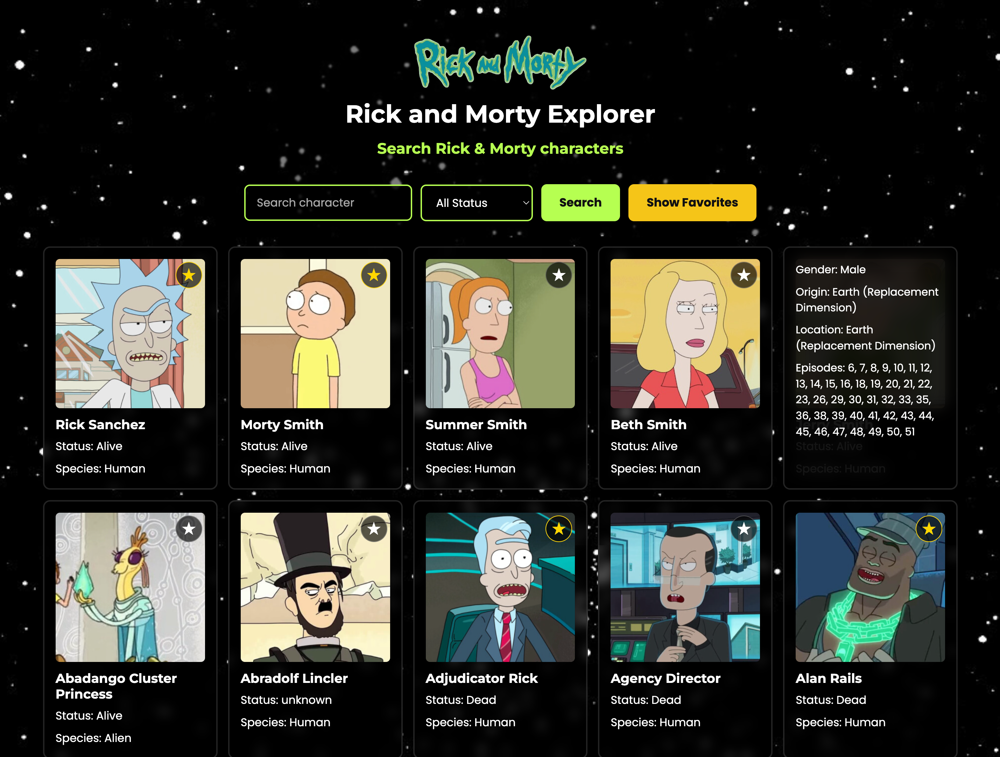

# Rick and Morty Explorer

A responsive web app to search, browse and save your favorite characters from *Rick and Morty*. It uses the public [Rick and Morty API](https://rickandmortyapi.com/) and is built with vanilla JavaScript, SCSS and Vite.

**Live demo:** [manuelaguileradev.github.io/rick-and-morty-explorer](https://manuelaguileradev.github.io/rick-and-morty-explorer/)



---

## Features

- **Search by name.** Find any character by typing part of their name.
- **Filter by status.** Combine the search with a filter for Alive, Dead or Unknown.
- **Load more.** Fetch the next page of results without losing the active filters.
- **Character details.** Click a card to show or hide gender, origin, current location and the episodes the character appears in.
- **Favorites.** Mark characters with the ★ button and see them all with **Show Favorites**. Favorites are saved in `localStorage`, so they are still there after reloading the page.
- **Responsive layout.** Mobile-first grid that grows from 1 to 5 columns depending on screen width.
- **Loading, error and end-of-results states.** The user always gets clear feedback.

## Tech stack

| Area | Tools |
|------|-------|
| Language | JavaScript (ES modules) |
| Build tool / dev server | [Vite](https://vite.dev/) |
| Styling | SCSS ([Sass](https://sass-lang.com/)) with partials, variables and mixins; Google Fonts (Montserrat, Poppins) |
| Data | [Rick and Morty REST API](https://rickandmortyapi.com/documentation) via `fetch` |
| Persistence | Browser `localStorage` |
| Hosting | GitHub Pages |

No frameworks and no runtime dependencies. The goal was to master DOM manipulation, async/await and modular code before moving to React.

## Getting started

### Prerequisites

- [Node.js](https://nodejs.org/) 20.19 or newer (required by Vite)
- npm (comes with Node.js)

### Installation

```bash
git clone https://github.com/manuelaguileradev/rick-and-morty-explorer.git
cd rick-and-morty-explorer
npm install
npm run dev
```

Then open the URL Vite prints in the terminal (usually `http://localhost:5173`).

### Available scripts

| Command | What it does |
|---------|--------------|
| `npm run dev` | Starts the dev server with hot reload |
| `npm run build` | Creates the production build in `docs/` |
| `npm run preview` | Serves the production build locally |

## Project structure

```
├── index.html            # Page layout: header, search form, results grid
├── vite.config.js        # Base path for GitHub Pages and build output folder (docs/)
├── docs/                 # Production build served by GitHub Pages (generated, do not edit)
└── src/
    ├── main.js           # Entry point: wires events to API, state, favorites and UI
    ├── api.js            # Builds the request URL and calls the API
    ├── state.js          # Keeps the loaded characters and the next-page URL
    ├── favorites.js      # Reads and writes favorites in localStorage
    ├── ui.js             # Renders cards, details, loading and error messages
    ├── assets/           # Logo and background image
    └── styles/
        ├── main.scss         # Imports all partials
        ├── _variables.scss   # Colors, fonts and breakpoints
        ├── _mixins.scss      # Media query and button mixins
        ├── _base.scss        # Global styles and typography
        ├── _layout.scss      # Header, form and responsive grid
        └── _components.scss  # Inputs, buttons, cards and details overlay
```

The code is split by responsibility. `api.js` only talks to the network, `ui.js` only touches the DOM, `state.js` holds the data on screen and `favorites.js` owns everything related to `localStorage`. `main.js` connects them.

## How it works

1. On load, the app requests `GET /api/character` and renders the first 20 characters.
2. When you submit the form, `api.js` builds the query with `URLSearchParams`. For example:
   ```
   https://rickandmortyapi.com/api/character?name=rick&status=alive
   ```
3. Every API response includes `info.next`, the URL of the next page with the same filters. The app stores it in `state.js`, and **Load More** requests that exact URL. That way pagination never loses the active search.
4. Clicking a card looks up the character by `id` in the stored state, so the details open without another request.
5. Clicking ★ adds or removes the full character object in `localStorage` under the key `favorites`. **Show Favorites** renders that list and hides the search controls; **Go Back** restores the previous results.

## Deployment

The site is served by GitHub Pages from the `docs/` folder on the `main` branch. `vite.config.js` sets `base: "/rick-and-morty-explorer/"` so asset paths work under the repository subpath, and `build.outDir: "docs"` so the build goes straight to that folder.

To publish changes:

```bash
npm run build
git add .
git commit -m "Update build"
git push
```

## Troubleshooting

| Symptom | Likely cause | How to fix or check |
|---------|--------------|---------------------|
| `Something went wrong: 404` after a search | The API returns **404 Not Found** when no character matches the name and status combination. Nothing is broken. | Check the spelling or set the filter to *All Status*. You can confirm in DevTools → **Network**: the request shows status `404` with the body `{"error":"There is nothing here"}`. |
| Favorites disappeared | Favorites live in the browser's `localStorage`, so they are tied to one browser on one device. Clearing site data or using a private window starts with an empty list. | DevTools → **Application** → **Local Storage** → check the `favorites` key. |
| Nothing loads and there is no error message | The page was opened directly from the file system (`file://`). Vite modules need a dev server. | Run `npm run dev` and use the `localhost` URL. |
| Blank page or missing styles on GitHub Pages | The `base` in `vite.config.js` does not match the repository name, so assets are requested from the wrong path. | DevTools → **Network** will show `404` on `.js` and `.css` files. Make `base` match `/<repo-name>/` and rebuild. |
| `Something went wrong: 429` | Too many requests to the API in a short time (rate limiting). | Wait a few seconds and try again. |
| `TypeError: Failed to fetch` in the Console | No internet connection, or the API is down. | Open [the API endpoint](https://rickandmortyapi.com/api/character) in a new tab. If it doesn't load, the problem is not in the app. |
| `npm run dev` fails with a Node version error | Vite requires a recent Node.js version. | Run `node -v` and update to 20.19 or newer. |

## Roadmap

- [ ] Friendly "No characters found" message instead of the raw 404 error
- [ ] Favicon

## What I learned

- Consuming a paginated REST API and reusing `info.next` instead of building page numbers by hand.
- Reading HTTP status codes (`200`, `404`, `429`) and turning them into messages for the user.
- Persisting data in the browser with `localStorage` and `JSON.stringify` / `JSON.parse`.
- Separating code into modules (API, state, favorites, UI) so each part is easier to test and debug.
- Event delegation: one click listener on the grid handles every card and every ★ button, including ones added later.
- Building and deploying a Vite project to GitHub Pages under a subpath.

## AI-assisted development

The SCSS architecture and styles were generated with the agent in Antigravity IDE, then reviewed and adjusted by me. The JavaScript logic (API, state, favorites and UI modules) was written by hand as part of the ConquerBlocks Full Stack bootcamp.

## Credits

- Data and images from [The Rick and Morty API](https://rickandmortyapi.com/) by Axel Fuhrmann.
- *Rick and Morty* is created by Justin Roiland and Dan Harmon and owned by Adult Swim. This is a non-commercial learning project.

## Author

**Manuel Aguilera** · [GitHub](https://github.com/manuelaguileradev) · [LinkedIn](https://www.linkedin.com/in/manuelaguileradev)
